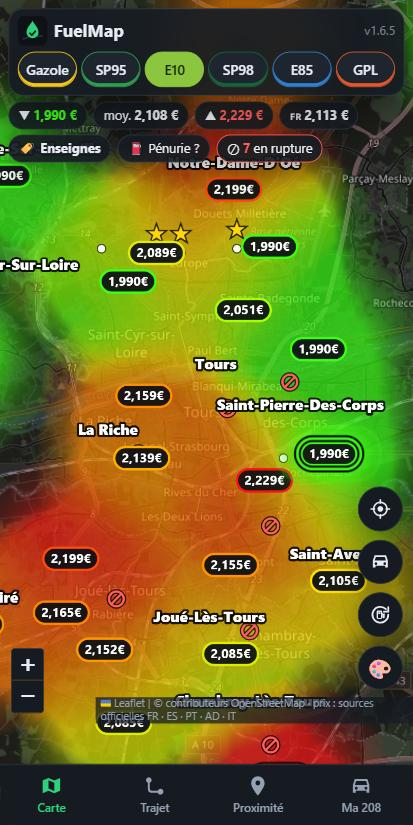
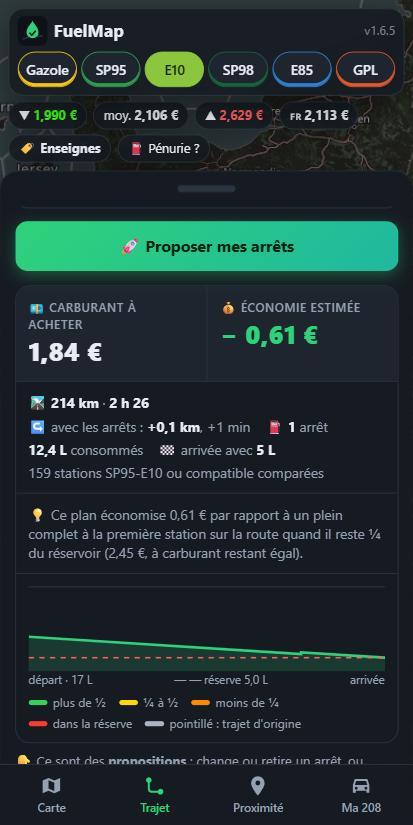
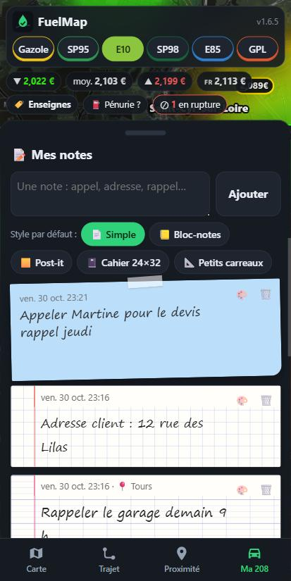
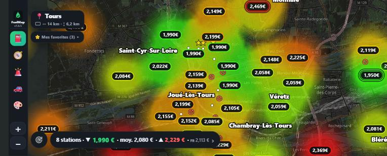
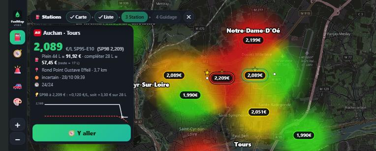
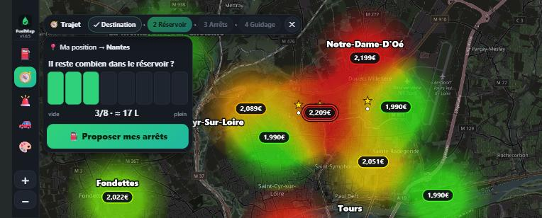
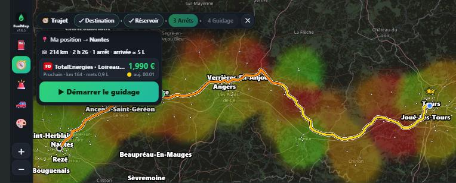
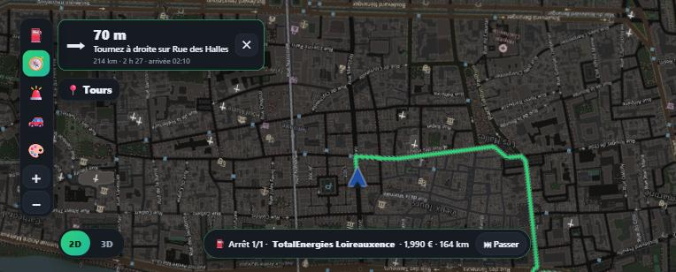
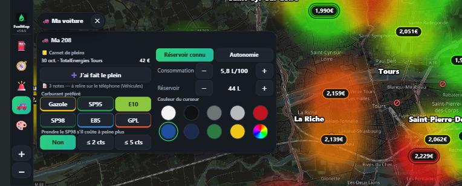

# FuelTrajetMap (FuelMap)

Carte des prix des carburants + **optimiseur de pleins sur trajet**, selon ton véhicule, et un **écran Android Auto**
avec guidage multi-arrêts. Appli web installable (Android, iOS, PC) et appli Android, **sans backend** : une page
statique qui interroge directement les données officielles et fait tous les calculs sur l'appareil.
Site en ligne : https://soaresden.github.io/FuelTrajetMap/

Inspiré par [plein-moins-cher.fr](https://plein-moins-cher.fr/) et son appli Fillgo, avec ce qui leur manquait :
un profil véhicule, et un calcul des arrêts sur un trajet qui optimise vraiment le budget (où s'arrêter *et* combien
de litres mettre).

  
  
  

Carte des prix · trajet optimisé (Tours → Nantes, « Ma 208 ») · bloc-notes

  
  
  
  
  
  

Écran Android Auto (1193×480) : carte · fiche station · réservoir · arrêts · guidage · Ma voiture

## Pourquoi c'est rapide

- Toute la France (~9 800 stations, ~950 Ko compressés) est chargée **une fois**, gardée en cache (IndexedDB) et
  réaffichée instantanément au lancement suivant ; actualisation en arrière-plan au-delà de 10 min, ou tout de suite
  avec le bouton ⛽ d'actualisation.
- Une seule couche `<canvas>` maison (heatmap de prix + points + pastilles + noms de villes) : ~20 ms pour redessiner
  la France entière sur mobile. Aucun marqueur DOM, aucun aller-retour serveur quand on bouge la carte.
- Aucun serveur à maintenir ni à payer : les données viennent des sources officielles et de GitHub Pages.

## Sur le téléphone

1. **Premier lancement** : saisie d'un véhicule (nom, carburant, contenance, consommation, réserve, couleur). Dans
   l'appli Android, on choisit aussi de **restaurer une sauvegarde** ou de partir de zéro.
2. **Carte** : en haut le logo, la version et les 6 carburants sur toute la largeur, aux couleurs des pistolets à la
   pompe. Heatmap des prix du carburant choisi (vert = pas cher, rouge = cher, échelle recalculée sur la zone visible),
   prix écrits dans des pastilles, la moins chère et la plus chère encadrées, noms des villes dessinés par l'appli.
   Barre de stats : prix mini, moyen, maxi de la zone et moyenne France, en €. Une alerte s'affiche si les prix publiés
   sont anormalement anciens. Le bouton de position suit la voiture.
3. **Trajet** : niveau actuel (jauge en huitièmes) → départ → arrivée → *Proposer mes arrêts*. Le résultat est une
   **proposition modifiable** : pour chaque arrêt, « Changer » liste les autres stations possibles avec l'écart de coût
   total, « Retirer » le supprime, et toucher une station sur la carte permet de s'y arrêter. Le trajet réel (via les
   arrêts) est recalculé et coloré selon le niveau du réservoir ; le trajet d'origine reste en pointillé en fond.
   Résumé : carburant à acheter, économie estimée, détour, litres consommés, niveau à l'arrivée.
4. **Proximité** : classement par *coût réel du plein* (prix × litres + carburant de l'aller-retour), note /10 ou
   « fiable d'abord » ; origine GPS, centre de la carte, favoris ou n'importe quelle adresse.
5. **Pénurie** : ruptures déclarées barrées ⊘, indice de confiance « il y a du carburant ? », carte par fraîcheur.
6. **Véhicules** : plusieurs véhicules, le nom du véhicule actif sur l'onglet. **Couleur du curseur** : la flèche et le
   point de position prennent la couleur de ta voiture, au choix depuis une table de teintes d'usine approchées
   (recherche « 208 bleu », « clio gris »…), depuis une **photo de ta voiture** (couleur dominante, un toucher sur la
   carrosserie l'ajuste ; la photo ne quitte pas le téléphone), ou depuis des photos du modèle sur Wikimedia Commons
   (« 🔎 Trouver ma couleur »).
7. **Option SP98** : pour une voiture E10/SP95, prendre le SP98 quand il coûte à peine plus (≤ 2 ou 5 centimes).
8. **Carnet de pleins** : en ouvrant l'appli près d'une station, elle demande « tu viens de faire le plein ? » ; pavé
   pour le montant payé, carburant modifiable, prix au litre repris de la station (ou saisi s'il est inconnu). Chaque
   plein garde la date, l'heure, la station, les litres et le véhicule. Relevés de compteur → consommation réelle.
9. **Bloc-notes** (« Mes notes ») : pour les appels pris en roulant, une adresse, un rappel. Notes écrites sur le
   téléphone ou dictées dans la voiture, datées et localisées (commune). Cinq styles choisis note par note (🎨) :
   simple, bloc-notes, post-it (couleur au choix), cahier 24×32 (Seyès), petits carreaux.
10. **Agenda** (appli Android) : les rendez-vous du calendrier qui ont un lieu sont proposés comme destinations.
11. **Thèmes** (bouton 🎨) : 6 clairs (Jour, GéMap, Sable, Menthe, Lavande, Contraste) et 6 foncés (Nuit, Wéyze,
    Ardoise, Océan, Ambre, Nuit noire) — interface et traitement du fond de carte (`js/themes.js`) ; les couleurs des
    prix ne changent pas. Le thème est partagé entre le téléphone et l'écran de la voiture.
12. **Alerte « il y a de l'essence »** (appli Android) : rayon de 1 à 10 km autour de ta position, du centre de la carte
    ou d'une adresse ; toutes les 15 min, l'appli regarde si une station de la zone vient de saisir un nouveau prix d'un
    carburant compatible, sans rupture déclarée, et notifie la moins chère (« SP95 à 1,990 € à Tours — gogogo ! »,
    bouton « Y aller »). Zone fixée à l'activation, aucune position suivie en arrière-plan.

### Tes données restent chez toi

Pas de compte, rien n'est envoyé à un serveur, et la sauvegarde automatique Android vers Google est **désactivée**.
Dans l'appli Android, tu choisis un **dossier de sauvegarde** sur le téléphone (ou une carte SD, un dossier
synchronisé de ton choix) : FuelMap y écrit `FuelMap-sauvegarde.json` (véhicules, favoris, carnet, notes, réglages) à
chaque changement, et le relit à la réinstallation. Dans le navigateur : export / import du même fichier.
Détails dans `privacy.html`.

### L'optimiseur (`js/optimizer.js`)

Programmation dynamique exacte du « gas station problem » : à chaque arrêt, soit on prend juste de quoi atteindre
l'arrêt suivant s'il est moins cher (appoint), soit on fait le plein s'il est plus cher. Pris en compte : détour de
chaque station, réserve de sécurité jamais entamée, niveau voulu à l'arrivée, « prix » d'un arrêt (pour éviter les
micro-arrêts). Vérifié contre une recherche exhaustive sur 4 000 cas aléatoires : `node tests/optimizer.test.js`.

Limites connues : le détour est estimé (distance à la route × 1,35 + 1 km hors autoroute) puis recalculé en vrai
pour les arrêts retenus ; le sens de circulation des aires d'autoroute n'est pas connu des données.

## Android Auto

L'écran de la voiture est la vraie carte FuelMap, plein écran, pensée comme Waze ou Google Maps : **la carte d'abord,
le reste par étapes**. Une colonne fine à gauche (logo et version en haut) porte cinq icônes, puis le zoom ＋/− :

- ⛽ **Stations** : Carte › Liste › Station › Guidage. Les prix sont écrits sur la carte ; le bouton du bas
  « 📋 N stations · dès x,xxx € » ouvre la liste. La fiche station donne le prix (et celui du SP98 entre parenthèses),
  le coût d'un plein et d'un complément, la fraîcheur du prix, la comparaison SP98, et l'**historique sur 30 jours**
  (la station, la moyenne à 10 km en rouge, les prix déclarés en croix).
- 🧭 **Trajet** : Destination › Réservoir › Arrêts › Guidage. Destination par recherche (clavier ou voix de la
  voiture), favoris, agenda, ou dernier trajet préparé sur le téléphone. **Le niveau du réservoir est toujours demandé
  avant le calcul.**
- 🚨 **Pénurie** : Autour de moi › Station › Guidage, classé par note fraîcheur-distance-prix (les prix poussés
  automatiquement à heure fixe, type 00:01, sont pénalisés).
- 🚗 **Ma voiture** : carnet de pleins (« ➕ J'ai fait le plein »), carburant préféré, option SP98, consommation, réservoir
  connu ou **autonomie** (« je fais environ 600 km par plein » → réservoir déduit), couleur du curseur (9 teintes + roue
  chromatique).
- 🎨 **Thème** : les 12 thèmes, appliqués tout de suite.

Les étapes s'affichent en **bulles** en haut (✓ = faite, touchable pour revenir) ; le contenu de l'étape est une carte
flottante à gauche. En haut à gauche : la commune où l'on est et la taille de la zone affichée, puis les favorites.

**Guidage FuelMap multi-arrêts** (sans passer par Google Maps) : itinéraire OSRM par tous les arrêts carburant puis la
destination, manœuvre suivante et heure d'arrivée affichées aussi par la voiture, voix dans les enceintes (« Arrêt
carburant, … », numéros et directions des sorties, « GPS perdu » en tunnel avec estimation de la position). Bandeau
« Arrêt 1/2 · station · prix · km [⏭ Passer] » ; « Remplacer l'arrêt » depuis une autre station ; à l'approche d'un arrêt,
les prix sont revérifiés. Vue 2D ou 3D, recalcul si on sort de la route, arrêt automatique après l'arrivée.

**Les yeux sur la route** : en roulant, plus de 6 touchers en 10 s bloquent l'écran 3 s (barre qui se vide). Le clavier
n'est proposé qu'à l'arrêt (règle de la voiture) ; en roulant, la voix. Bouton 📝 : dicter une note, retrouvée sur le
téléphone. L'écran partagé avec le lecteur de musique est géré : la page reprend là où elle en était.

Technique : la page web en mode voiture est dessinée sur la surface fournie par Android Auto (écran virtuel + WebView) ;
les gestes de l'hôte (glisser, pincer, toucher) sont relayés à la page. Le service est déclaré en catégorie
**navigation**, la seule qui donne droit au plein écran (`NavigationTemplate`) ; un hôte ancien a une version liste.
Google n'affiche dans la voiture que les applis de ce type **installées depuis le Play Store** (voir la
[doc de test](https://developer.android.com/training/cars/testing)). Pour tester sur PC sans voiture : le Desktop Head
Unit du SDK Android (`apk/dhu/`, non versionné), avec le mode développeur d'Android Auto activé sur le téléphone.

## Mode voiture (téléphone ou tablette sur support)

Bouton 🚗 sur la carte, ou `…/index.html?car=1` dans l'URL : gros contrôles, suivi GPS (le bouton de position reprend
le suivi après avoir bougé la carte) et un encart « prochaine station » en bas — prochain arrêt prévu du trajet, sinon
le meilleur plein à moins de 15 km — avec l'indice de confiance et « Y aller » en un tap.
`…/index.html?car=1&aa=1` donne l'écran Android Auto dans le navigateur, pratique pour le tester.

## Pays couverts

| Pays | Source | Dans le navigateur |
|---|---|---|
| France | prix-carburants.gouv.fr (data.economie.gouv.fr) | direct, sinon `data/fr.json` (secours) |
| Espagne | Ministerio para la Transición Ecológica | `data/es.json`, sinon direct (12 Mo) |
| Portugal | DGEG — *usage non commercial uniquement* | `data/pt.json`, sinon direct |
| Andorre | Govern d'Andorra (ArcGIS public) | `data/ad.json`, sinon direct |
| Italie | MIMIT, licence IODL 2.0 | **uniquement** `data/it.json` (la source n'autorise pas les navigateurs) |
| Belgique, Suisse, Luxembourg | aucune donnée ouverte par station (seulement des prix maximums nationaux en BE/LU) | — |
| Allemagne | Tankerkönig : clé API personnelle, non publiable dans une appli statique | — |

Les pays voisins ne sont chargés que si la carte (zoom ≥ 7) ou un trajet les touche. `data/*.json` est régénéré par
`node tools/build-data.mjs` — la GitHub Action fournie le fait toutes les 3 h, et échoue si les prix français publiés
ont plus d'un jour (source officielle arrêtée ?).
À l'étranger, une voiture SP95-E10 se voit proposer le SP95 (E5), compatible.

## Enseignes, historique, carburants compatibles

- **Enseignes** : absentes des données de l'État. `tools/build-data.mjs brands` les récupère dans OpenStreetMap (ODbL), où
  presque toutes les stations portent l'identifiant officiel (`ref:FR:prix-carburants`) : ~99 % de correspondance.
  Filtre « 🏷️ Enseignes » sur la carte, appliqué aussi à Proximité et aux arrêts d'un trajet.
- **Historique** : bouton « 📈 Historique » dans la bulle d'une station française (6 mois, par carburant), courbe de
  30 jours dans la fiche station de la voiture. `tools/build-data.mjs hist` le construit depuis l'archive annuelle
  officielle → `data/hist/<département>.json`.
- **Pastilles d'enseigne** : initiales sur fond coloré. L'appli ne fournit pas de logos (marques déposées), aux couleurs de l'enseigne ; elle affiche aussi les fichiers déposés dans `icons/brands/` (voir `LISEZ-MOI.txt`).
  Le sélecteur d'enseignes affiche le prix mini et moyen de chaque enseigne, triable.
- **Favoris** : « ☆ Favori » dans la bulle d'une station ; liste dans Proximité → ⭐ Favoris ; étoile sur la carte ;
  rappelés en haut à gauche de l'écran voiture avec leur prix.
- **Ruptures** : une station qui déclare ne plus avoir un carburant (données `*_rupture_type` / `*_rupture_debut` du flux
  de l'État, dans lequel le prix disparaît alors) apparaît **⊘ barrée en rouge** sur la carte, comptée dans la barre de
  stats, listée « ⊘ rupture déclarée » dans Proximité, datée dans sa fiche, et n'est jamais proposée sur un trajet ni sur
  Android Auto. Rupture « définitive » = la station ne vend plus ce carburant, son ancien prix est ignoré. L'information
  vient des gérants : en période de pénurie, une station non barrée peut quand même être à sec.
- **Horaires d'ouverture** (champ `horaires_jour` de l'État, 8 500 stations) : la fiche affiche « 🕒 ouverte jusqu'à 21:00 »
  ou « 🔒 fermée · ouvre demain à 07:00 », les stations fermées passent en fin de liste dans Proximité, la voiture ne
  propose jamais une station fermée, et l'alerte « il y a de l'essence » ignore les stations fermées à ce moment-là.
  Automate 24/24 = toujours ouverte pour le paiement par carte.
- **Habitudes de mise à jour** (`data/fr-habits.json`, 90 jours d'archive) : par station, nombre de mises à jour, heure la
  plus fréquente et sa part, profil horaire. Environ 1 700 stations poussent leur prix **automatiquement à heure fixe,
  même inchangé** (TotalEnergies à 00:01 pour plus de la moitié de ses stations, Shell 09:30, Dyneff 14:00, Eni 06:00,
  Avia 00:00/06:00) : ce passage est repéré 🤖, ne compte ni comme preuve de carburant (confiance plafonnée à
  « probable », fraîcheur plafonnée dans la note, pas de halo, pas d'alerte), et la fiche affiche l'habitude de la
  station (« manuelle, surtout entre 8 h et 10 h, 24 fois par mois »). Les heures publiées par l'État sont en heure de
  Paris (l'API open data leur colle « +00:00 » à tort) : l'appli les lit telles quelles.
- **Indice de confiance « il y a du carburant ? »** : faute de donnée officielle sur les cuves, l'appli se sert de
  l'heure du dernier prix déclaré par le gérant (un gérant qui vient de saisir un prix vend du carburant) : 🟢 mis à
  jour il y a moins de 6 h (très probable), 🟡 aujourd'hui (probable), 🟠 1 à 3 jours (incertain), ⚪ plus (inconnu),
  ⊘ rupture. Affiché dans la fiche station, dans Proximité et sur l'écran voiture. Le bouton **« ⛽ Pénurie ? »** de la
  barre de stats colore la carte par fraîcheur au lieu du prix (pastilles « 2 h », « hier »…) et trie Proximité par
  fraîcheur : pratique pour trouver une station qui a vraiment de l'essence.
- **Note /10** (indice maison) : d'abord l'heure du dernier prix (5 pts : 5 si moins d'une heure, 4,5 jusqu'à 6 h,
  2,5 pour la journée, presque rien au-delà de 3 jours, plafonnée à 1 en cas de rupture déclarée), puis la proximité
  (2 pts à moins d'un kilomètre, 0 à 15 km), puis le prix par rapport aux stations à 25 km (3 pts : part des voisines
  plus chères). Les prix saisis depuis moins de 2 h ont un halo animé sur la carte.
- **Carburants compatibles** : une voiture SP95-E10 se voit aussi proposer SP95 et SP98 quand ils sont moins chers ou
  seuls disponibles ; une voiture SP95 accepte le SP98 ; jamais l'inverse.

## Services utilisés (gratuits, sans clé)

Itinéraires : OSRM (serveur de démonstration, puis celui d'openstreetmap.de en secours ; liste `OSRM_SERVERS` dans
`js/app.js`). Adresses et communes : Géoplateforme IGN (France), API Adresse, Photon (Europe). Couleurs de modèles :
Wikimedia Commons. Fond de carte : OpenStreetMap. Carte : Leaflet (BSD-2).

## Lancer en local

Prérequis une seule fois : `node tools/build-data.mjs` (Node ≥ 18) pour remplir `data/` (prix des pays voisins,
enseignes, historique — la cible `hist` a besoin de la commande `unzip`, absente de Windows : sans elle, tout le
reste se construit quand même). Puis double-clique `lancer.bat` ou `python -m http.server 8080` → http://localhost:8080.

Tests : `node tests/optimizer.test.js` (optimiseur) ; `cd tests && npm install && node ecrans.test.mjs` vérifie que rien
ne se chevauche sur l'écran voiture à plusieurs tailles (Playwright + Edge, captures dans `tests/captures/`).

## Mettre en ligne (GitHub Pages)

1. Pousse ce dossier sur `main`. `data/` n'est pas versionné : la GitHub Action le régénère.
2. Settings → Pages → Source = **GitHub Actions**. Le workflow `.github/workflows/pages.yml` teste l'optimiseur,
   construit les données, vérifie leur fraîcheur et publie — à chaque push et toutes les 3 h.
3. Sur le téléphone : ouvre l'URL → menu → « Installer l'application ».

## Appli Android (`apk/`)

Projet Capacitor 7 (WebView + fichiers embarqués, GPS natif, Android Auto, alerte carburant, agenda, dossier de
sauvegarde). `apk\construire-apk.bat` copie l'appli dans `www/`, synchronise et lance Gradle (Node.js + SDK Android 36
+ **JDK 21**) ; il produit l'**AAB** de release (`app/build/outputs/bundle/release/app-release.aab`), signé avec la clé
d'upload si `apk/android/keystore/keystore.properties` existe — clé **jamais dans git**, à garder précieusement, elle ne
se remplace pas. Plus d'APK : l'appli s'installe par le Play Store (test interne). L'appli lit ses données (`data/`)
sur le site publié (`dataBase` dans `js/config.js`), donc toujours à jour.

## Mise à jour obligatoire

`MainActivity` déclenche la mise à jour « immédiate » du Play Store dès qu'une version
plus récente existe, et `version-min.json` (à la racine du site) fixe le `versionCode` minimal accepté : en dessous,
écran bloquant vers le Play Store. Monter ce nombre quand une ancienne version ne doit plus tourner (données ou calculs
changés).

## Publier sur le Play Store

1. Dans la Play Console : appli « FuelMap », package `fr.soaresden.fuelmap`, gratuite. Politique de confidentialité : `https://soaresden.github.io/FuelTrajetMap/privacy.html` ; sécurité des
   données : position utilisée sur l'appareil, rien de collecté.
2. **Tests → Test interne** : téléverser l'AAB, créer la liste de testeurs (Gmail), envoyer le lien d'inscription ;
   installer depuis le Play Store. Pas de revue Google en test interne ; FuelMap apparaît alors dans la voiture.
3. Sortie publique : test fermé de 14 jours avec 12 testeurs, puis revue Google, dont celle d'Android Auto (la catégorie
   navigation est examinée de près ; FuelMap a son propre guidage).

**Nouvelle version** : monter ensemble `versionCode` (toujours croissant, jamais réutilisé : Google le grille dès qu'un
AAB est téléversé) et `versionName` dans `apk/android/app/build.gradle`, `version` dans `js/config.js` et le nom du
cache dans `sw.js` ; construire, téléverser l'AAB dans le test interne (puis les autres canaux), pousser le site. Si
l'ancienne version ne doit plus tourner, monter aussi `android` dans `version-min.json`.

## Licence

Code « source visible » : lisible et modifiable pour contribuer, mais pas de redistribution ni de copie de l'appli ou
du service (voir `LICENSE`). Les prix restent soumis aux conditions de leurs sources (voir tableau ci-dessus).
